<p align="center">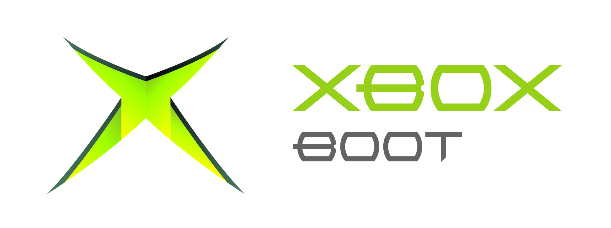</p>

The boot animation of the original Xbox — the glowing blob, the chamber
around it, the logo that flies in at the end — reconstructed from a single
BIOS image alone, and rebuilt from that reconstruction as a standalone
renderer with a WebGPU front end.

> [!NOTE]
> The analysis, the specification and the rebuild in this repository were
> produced mainly by Claude Opus 5.5, an AI model by Anthropic, working
> inside Claude Code. A human directed the work throughout: decided what to
> pursue and reviewed the result, but did not write most of it line by
> line. Treat the content accordingly.

## Screenshots

<table><tr>
<td>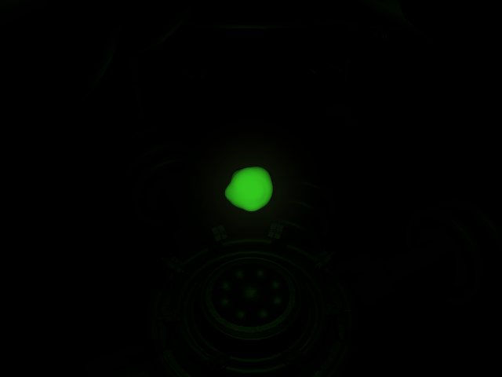</td>
<td>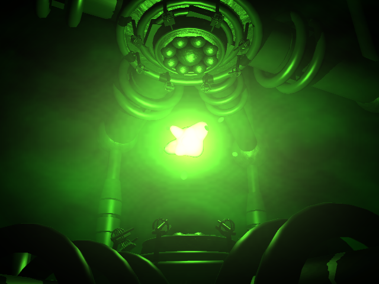</td>
<td>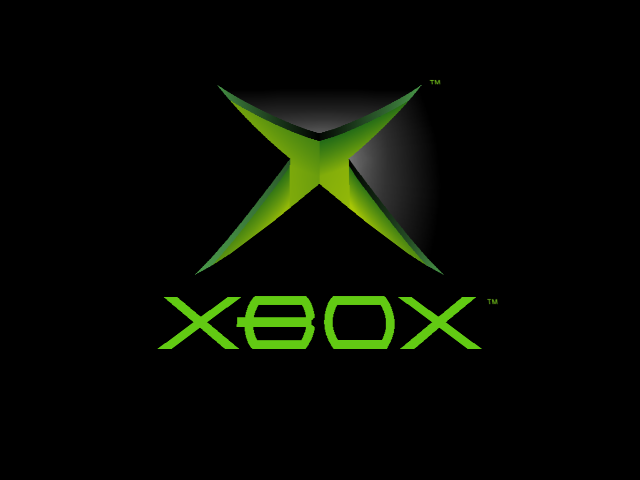</td>
</tr></table>

The workbench (`hosts/web/`, [live demo](https://bennyborn.de/xbox-boot-re/))
besides the picture itself: free camera, and the mesh of every part as
wireframe over it.

<table><tr>
<td>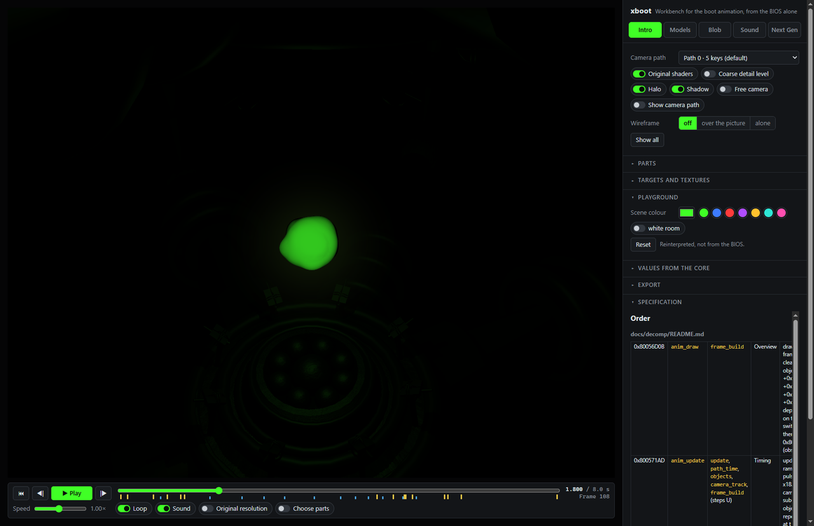</td>
<td>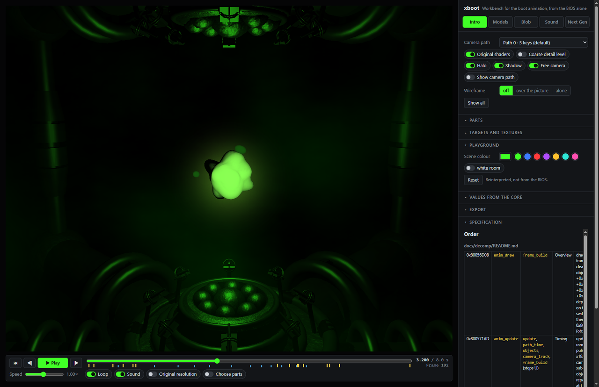</td>
<td>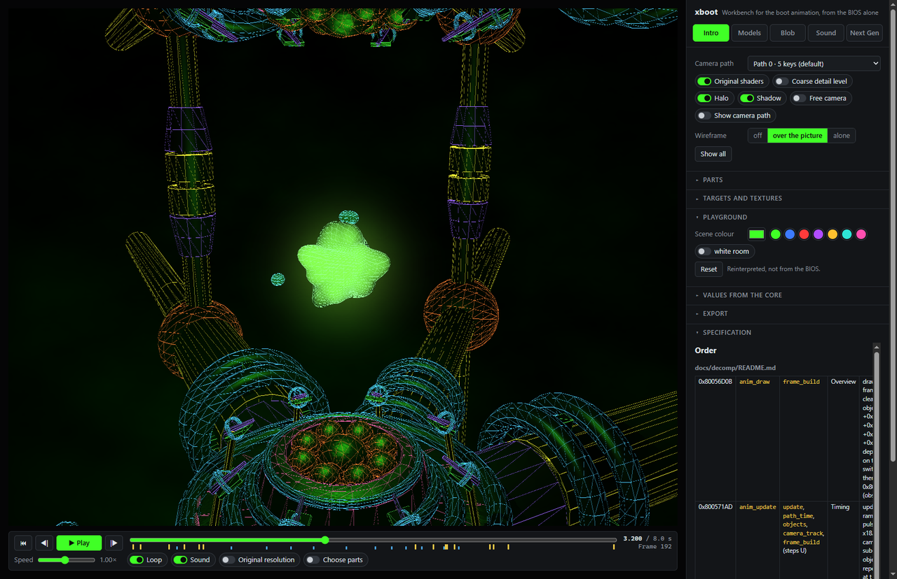</td>
</tr></table>

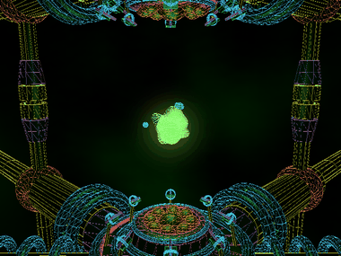

A viewer for every mesh of the core on its own, the sound as a track view
of its 16 channels, and the blob tab with every diagnostic on: markers at
its bulges, the mesh seen through its surface, the trails of its drops.

<table><tr>
<td>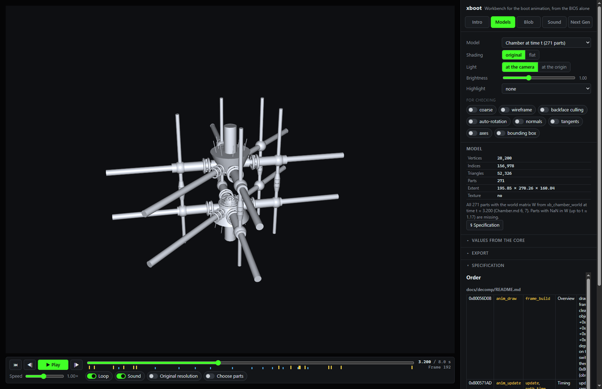</td>
<td>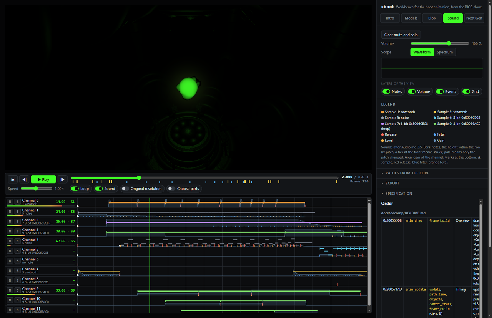</td>
<td>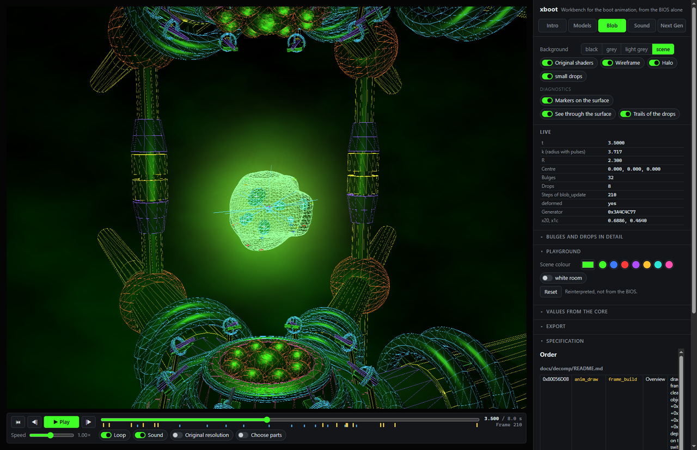</td>
</tr></table>

## Result

Time keeping, camera and chamber geometry, the blob, the logo, the
CPU-generated textures, and the full GPU command stream with its constants
and state all match the original, bit for bit, against recorded runs in the
xemu emulator; the sound sequencer and its DSP program match it and a
reimplementation of xemu's DSP core, word for word. The only deliberate
approximation is the audio voice synthesis, which follows xemu's reading of
the hardware (not otherwise documented) rather than the BIOS itself.

The rebuild (`core/`) is a portable C core written directly to that
specification, with no reference to any other implementation, compiled for
a native host and for wasm32. The web port (`hosts/web/`) renders it with
WebGPU, reproduces the look of the original, and adds a workbench for
inspecting the animation part by part plus a reinterpreted "Next Gen"
rendering of the same choreography with ray-traced reflections, soft
shadows, god rays and depth of field.

Everything rests on one BIOS image: `bios_complex_4627_retail.bin` (SHA-256
`3d5fae186cb31b5a6331155e532ef63e493afd85d7af8576fb52c95d0ce0362c`), the
1 MB "Complex 4627 Retail (1.0)" image — a modified BIOS, not a stock
dump — flashed on the author's own (modded) console and dumped from it,
decrypted with the MCPX key of the same console. No other BIOS version
was used, and no name, structure or constant
was taken from memory or from any other documentation of the hardware —
every statement has an address in the binary, a recorded run, or a
third-party source behind it, listed in `docs/provenance.md`.

## Running it

Needs clang from LLVM 23.1.3 at `.tools/llvm/` (exact files and hash in
`docs/provenance.md`) and Node.js for the web port.

```
python core/build.py            # builds the core and the wasm port, runs the host tests
node hosts/web/serve.mjs         # http://127.0.0.1:8360/
```

`docs/core.md` and `docs/web.md` have the details.

## Where to look

| What | Where |
|---|---|
| Provenance of every statement | `docs/provenance.md` |
| Main table address → name → description | `docs/decomp/README.md` |
| Narratives per subsystem, the actual specification | `docs/decomp/*.md` |
| Test vectors from xemu | `docs/vectors/` |
| Data extracted from the ROM | `data/` |
| Tools | `tools/` |
| Portable core in C | `core/`, described in `docs/core.md` |
| Hosts: command line, web port | `hosts/native/`, `hosts/web/` with `docs/web.md` |

## Data

`data/` holds geometry, samples and tables from the ROM. Their content is
Microsoft's work; the extractors in `tools/extract/` take them from the
BIOS, so anyone with the same ROM can produce them again. They live in this
one folder only, so that they can be taken out at any time.

## Local only

`rom/`, `.tools/`, `ref/` and `out/` are gitignored and do not come with a
clone. Building only needs clang in `.tools/llvm/` as above; `out/` then
fills itself. Redoing the analysis or the xemu recordings instead needs
your own BIOS dump in `rom/` and the rest of the tool set in `.tools/`,
listed with version and source in `docs/provenance.md`.

## Thanks

This project stands on the work of others: [Ghidra](https://github.com/NationalSecurityAgency/ghidra)
for the static analysis, the [xemu](https://xemu.app/) emulator for every
run and recording measured against, [XboxBiosTool](https://github.com/tommojphillips/XboxBiosTool)
as an independent check of the BIOS unpacking, and LLVM/clang for building
the core itself.

## Special Thanks

Most special thanks to [Pipeworks Studios](https://www.pipeworks.com/) (originally
Pipeworks Software, Inc.) for the boot animation itself, created back in
2001 — the thing this whole repository is about.
